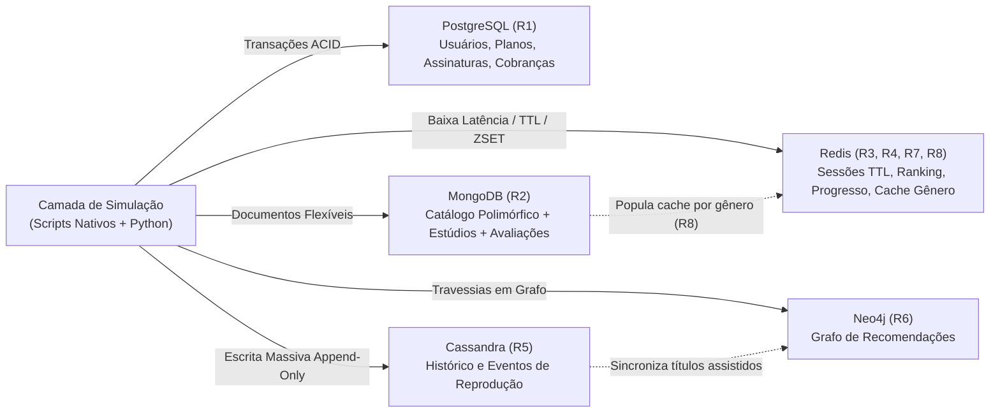

# UniStream — Persistência Poliglota Aplicada a uma Plataforma de Streaming

**Disciplina:** Desenvolvimento e Persistência de Dados — Universidade de Rio Verde (UniRV)  
**Tema:** Grupo 2 — Plataforma de Streaming (`R1` a `R8`)  

Este repositório implementa a camada de persistência poliglota da plataforma de streaming **UniStream**, combinando cinco tecnologias obrigatórias de banco de dados (**PostgreSQL, Redis, MongoDB, Cassandra e Neo4j**) orquestradas por um único `docker-compose.yml` e integradas por um contrato único de identificadores UUID ([CONTRATO_IDS.md](CONTRATO_IDS.md)).

---

## 1. Arquitetura Geral e Fluxo de Dados



---

## 2. Mapeamento de Requisitos (`R1`–`R8`)

| Req. | Descrição Resumida | Banco Escolhido | Justificativa Técnica |
| :--- | :--- | :--- | :--- |
| **R1** | Assinatura, cobrança do plano e liberação de acesso atômicas | **PostgreSQL** | Transações ACID (`BEGIN/COMMIT/ROLLBACK`) com integridade referencial e precisão monetária `NUMERIC`. |
| **R2** | Catálogo com atributos distintos por tipo (filme, série, documentário) | **MongoDB** | Modelo documental polimórfico (`$jsonSchema` extensível) permite objetos heterogêneos e episódios embutidos sem `NULL`s nem `JOIN`s. |
| **R3** | Sessão do usuário por dispositivo expirando sozinha | **Redis** | Expiração nativa por TTL (`EX` / `EXPIRE`) com remoção automática em memória sem rotina de limpeza (*cron*). |
| **R4** | Ranking semanal dos mais assistidos sempre ordenado | **Redis** | Estrutura `Sorted Set (ZSET)` mantém ordenação automática em `O(log N)` via `ZINCRBY` e `ZREVRANGE`. |
| **R5** | Eventos de reprodução em altíssimo volume e histórico por usuário | **Cassandra** | Arquitetura distribuída *masterless* e motor *LSM-Tree* otimizado para escrita sequencial contínua com particionamento temporal. |
| **R6** | *"Quem assistiu também assistiu"* e usuários com gosto parecido | **Neo4j** | *Index-Free Adjacency* executa travessias multi-salto (2–3 saltos) em tempo proporcional aos vizinhos locais, sem `JOIN`s pesados. |
| **R7** | Ponto exato de parada atualizado a cada poucos segundos | **Redis** | Baixa latência sub-milissegundo em memória (`Hash`) suporta leituras e atualizações frequentes sem sobrecarregar bancos em disco. |
| **R8** | Listagem rápida por gênero sem consultar o banco principal | **Redis** | Camada de cache em memória alimentada pelo MongoDB (`catalogo:genero:<slug>`) reduz latência e carga de leitura. |

---

## 3. Estrutura do Repositório e Divisão de Responsabilidades

```text
trabalho-persistencia-poliglota/
├── docker-compose.yml          # Sobe os 5 bancos em uma única rede e comando
├── CONTRATO_IDS.md             # UUIDs e padrões de chaves compartilhados pelos 5 bancos
├── requirements.txt            # Drivers Python (pymongo, cassandra-driver, neo4j, psycopg, redis)
├── postgres/                   # [Colega] R1 — Scripts SQL + guia de encaixe (postgres/README.md)
├── redis/                      # [Colega] R3, R4, R7, R8 — Comandos Redis + guia (redis/README.md)
├── mongodb/                    # [Rian] R2 — criacao.js, carga.js, demonstracao.js
├── cassandra/                  # [Rian] R5 — criacao.cql, carga.cql, demonstracao.cql
├── neo4j/                      # [Rian] R6 — criacao.cypher, carga.cypher, demonstracao.cypher
├── scripts/                    # Scripts Python de demonstração e orquestrador run_all.py
├── outputs/                    # Saídas reais capturadas durante a execução
└── docs/GUIA_RELATORIO.md      # Base técnica e diagramas dos bancos para o relatório ABNT
```

---

## 4. Pré-requisitos e Execução com Um Comando

- **Obrigatório:** Docker Desktop (ou Docker Engine + Compose v2) em execução.
- **Opcional (para rodar a suíte Python):** Python 3.12+.

### 4.1 Subir os cinco bancos

```bash
docker compose up -d
```

Acompanhe a inicialização até todos os 5 containers ficarem com status `healthy` (o Cassandra leva cerca de 45–90s no primeiro boot):

```bash
docker compose ps
```

| Serviço | Container | Porta(s) | Credenciais / Banco |
| :--- | :--- | :--- | :--- |
| PostgreSQL | `streaming-postgres` | `5432` | usuário `admin` / senha `123456` / db `streaming` |
| Redis | `streaming-redis` | `6379` | sem senha (AOF habilitado) |
| MongoDB | `streaming-mongodb` | `27017` | sem auth / db `streaming` |
| Cassandra | `streaming-cassandra` | `9042` | sem auth / keyspace `streaming` |
| Neo4j | `streaming-neo4j` | `7474` (Web), `7687` (Bolt) | usuário `neo4j` / senha `senha123` |

---

## 5. Executando os Scripts Nativos (Criação, Carga e Demonstração)

### MongoDB (`R2`)
```bash
docker exec streaming-mongodb mongosh --quiet streaming /scripts/mongodb/criacao.js
docker exec streaming-mongodb mongosh --quiet streaming /scripts/mongodb/carga.js
docker exec streaming-mongodb mongosh --quiet streaming /scripts/mongodb/demonstracao.js
```

### Cassandra (`R5`)
```bash
docker exec streaming-cassandra cqlsh --request-timeout=60 -f /scripts/cassandra/criacao.cql
docker exec streaming-cassandra cqlsh --request-timeout=60 -f /scripts/cassandra/carga.cql
docker exec streaming-cassandra cqlsh -f /scripts/cassandra/demonstracao.cql
```

### Neo4j (`R6`)
```bash
docker exec streaming-neo4j cypher-shell -u neo4j -p senha123 -f /scripts/neo4j/criacao.cypher
docker exec streaming-neo4j cypher-shell -u neo4j -p senha123 -f /scripts/neo4j/carga.cypher
docker exec streaming-neo4j cypher-shell -u neo4j -p senha123 -f /scripts/neo4j/demonstracao.cypher
```
> **Visualização gráfica:** acesse `http://localhost:7474` (login `neo4j` / `senha123`) e execute `MATCH (n)-[r]->(m) RETURN n, r, m;` para visualizar o grafo de recomendações ao vivo.

### PostgreSQL (`R1`) e Redis (`R3, R4, R7, R8`)
Consulte os guias de integração em [postgres/README.md](postgres/README.md) e [redis/README.md](redis/README.md).

---

## 6. Executando via Orquestrador Python (Carga + Demonstrações + Outputs)

```bash
python -m venv .venv
# Windows PowerShell:
.\.venv\Scripts\Activate.ps1
# Linux/macOS:
# source .venv/bin/activate

pip install -r requirements.txt
python scripts/run_all.py
```

O script `scripts/run_all.py`:
1. Verifica a saúde dos 5 containers;
2. Executa os scripts nativos de criação e carga (e detecta automaticamente os scripts de `postgres/` e `redis/` assim que forem adicionados);
3. Executa as demonstrações Python (`demo_mongodb.py`, `demo_cassandra.py`, `demo_neo4j.py`) e grava os logs completos em `outputs/`.

Para rodar apenas as demonstrações sem recriar os dados:
```bash
python scripts/run_all.py --skip-seed
```
