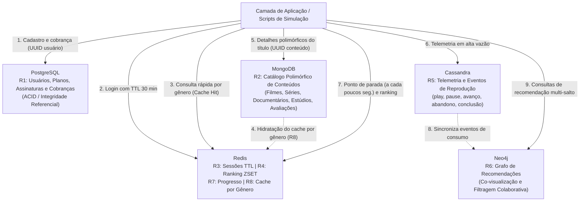
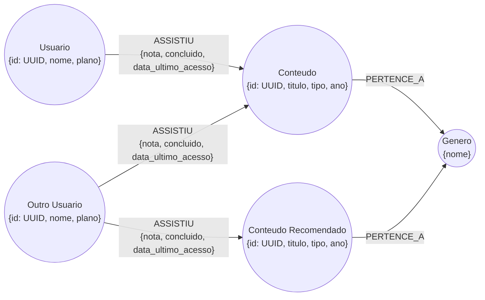

# Guia de Apoio ao Relatório Técnico (ABNT) e Arguição — UniStream

Este material segue a estrutura oficial do modelo de relatório da disciplina (**Seções 1.1, 1.2, 2.2, 2.4 e 2.5**) para apoiar a redação final do relatório em ABNT e a preparação de todos os integrantes para a arguição presencial de **01/12/2026**.

---

## Seção 1.1 — Diagrama da Arquitetura Geral (Figura 1)

> **Sugestão de título no relatório:** `Figura 1 – Arquitetura de persistência poliglota da plataforma UniStream`  
> **Fonte abaixo da figura (corpo 10):** `Fonte: elaborado pelos autores (2026)`



**Parágrafo pronto de leitura do desenho:**
> A Figura 1 apresenta a arquitetura de persistência poliglota da plataforma UniStream, na qual cada um dos cinco bancos de dados atende aos requisitos compatíveis com seu modelo de armazenamento e padrão de acesso. O fluxo inicia-se no PostgreSQL, responsável pelo registro transacional (ACID) de usuários, planos, assinaturas e cobranças, emitindo o identificador único (`usuario_id` em UUID) propagado para toda a arquitetura. Em seguida, o Redis gerencia as sessões por dispositivo com expiração automática, o cache de listagem por gênero alimentado pelo MongoDB, o ponto exato de parada durante a reprodução e o ranking semanal ordenado. O catálogo heterogêneo de filmes, séries e documentários reside no MongoDB, enquanto a telemetria contínua de eventos de reprodução em altíssimo volume é persistida de forma distribuída no Cassandra. Por fim, os vínculos entre usuários e conteúdos assistidos são materializados no Neo4j, permitindo recomendações por filtragem colaborativa sem sobrecarregar os demais bancos.

---

## Seção 1.2 — Quadro Resumo: Quem Atende o Quê

| Req. | Banco escolhido | Por que este banco (característica técnica) |
| :--- | :--- | :--- |
| **R1** | **PostgreSQL** | Suporte nativo a transações **ACID** (`BEGIN/COMMIT/ROLLBACK`), chaves estrangeiras e tipo decimal exato (`NUMERIC`), garantindo que usuário, assinatura, cobrança e liberação de acesso ocorram de forma atômica sem estados parciais. |
| **R2** | **MongoDB** | Modelo **documental BSON flexível** com validação parcial (`$jsonSchema` extensível) que permite armazenar filmes, séries (com temporadas/episódios embutidos) e documentários na mesma coleção sem colunas `NULL` nem migrações `ALTER TABLE`. |
| **R3** | **Redis** | **Expiração nativa por TTL** (`EX 1800`) associada a cada chave em memória, removendo sessões inativas automaticamente após 30 minutos em `O(1)` sem necessidade de rotinas periódicas (*cron jobs*) ou varreduras em disco. |
| **R4** | **Redis** | Estrutura **`Sorted Set` (`ZSET`)** baseada em *skiplist* e tabela hash, que mantém o ranking semanal continuamente ordenado em `O(log N)` a cada incremento (`ZINCRBY`) e entrega o Top N com `ZREVRANGE` em tempo sub-milissegundo. |
| **R5** | **Cassandra** | Arquitetura distribuída **sem ponto único de falha (*masterless*)** com motor **LSM-Tree** (*append-only* em *Memtable* + *SSTable*), escalando linearmente para milhões de escritas/hora, e leitura sequencial rápida pela *partition key* `(usuario_id, ano_mes)` com ordenação nativa pela *clustering key* `evento_ts DESC`. |
| **R6** | **Neo4j** | Armazenamento nativo em grafo com ***Index-Free Adjacency*** (cada nó mantém ponteiros diretos para suas arestas), executando travessias de 2 a 3 saltos (*"quem assistiu também assistiu"* e usuários similares) em tempo proporcional ao subgrafo local, independente do tamanho total da base. |
| **R7** | **Redis** | Operação **em memória RAM (*single-threaded event loop*)** com estrutura `Hash`, permitindo leituras e atualizações de ponto de parada a cada poucos segundos em latência sub-milissegundo com persistência configurável via *AOF* sem gerar contenção de disco ou *locks*. |
| **R8** | **Redis** | Cache de leitura em memória (`catalogo:genero:<slug>`) com acesso `O(1)`/`O(N)` direto em RAM, servindo a tela de navegação por gênero sem enviar consultas analíticas ou buscas repetitivas ao MongoDB. |

---

## Seção 2.2 — MongoDB (Sua Parte: R2)

### Papel no sistema
O MongoDB armazena o catálogo completo de conteúdos audiovisuais da plataforma UniStream (`conteudos`), além das coleções auxiliares `estudios` e `avaliacoes`. Em uma plataforma de streaming, cada categoria de mídia possui estrutura própria: filmes exigem duração, diretor e elenco; séries organizam-se hierarquicamente em temporadas e episódios com durações individuais; e documentários demandam tema, ano de produção, narrador e locais de filmagem ou especialistas entrevistados.

Ao centralizar esse catálogo em documentos BSON dentro de uma única coleção polimórfica (`conteudos`), a aplicação consulta e exibe títulos heterogêneos sem depender de múltiplas tabelas esparsas ou junções complexas. O MongoDB também atua como fonte de verdade do catálogo de gêneros, fornecendo a lista de títulos por `genero_slugs` que hidrata a camada de cache no Redis (`R8`), enquanto compartilha o mesmo UUID `_id` com Cassandra e Neo4j.

### Requisitos atendidos
- **R2** (atendimento direto: catálogo flexível para filmes, séries e documentários).
- Apoia indiretamente o **R8**, fornecendo a listagem autoritativa por gênero indexada via *multikey index* (`genero_slugs`) para popular o cache no Redis.

### Modelo de dados — Figura 3 (O que foi embutido vs. referenciado)

> **Sugestão de título:** `Figura 3 – Estrutura polimórfica dos documentos e estratégia de embutimento/referência no MongoDB`

**Decisões explícitas de modelagem:**
1. **Embutido (*Embedded*):**
   - `idiomas_disponiveis` (`{audio: [...], legendas: [...]}`): sempre exibido junto ao título e tem tamanho pequeno e limitado.
   - Atributos específicos de cada tipo (`duracao_minutos`, `diretor`, `elenco` em filmes; `temporadas[].episodios[]` em séries; `tema`, `ano_producao`, `narrador` em documentários): pertencem exclusivamente àquele conteúdo e são lidos juntos na tela de detalhes em uma única requisição sem `JOIN`.
2. **Referenciado (*Referenced*):**
   - `estudio_id` → coleção `estudios`: evita duplicar informações da produtora (nome, país, site) em dezenas de títulos e permite atualizar o estúdio em um único lugar.
   - Coleção `avaliacoes` (`conteudo_id`, `usuario_id`, `nota`, `comentario`): **nunca deve ser embutida** dentro de `conteudos`, pois um título popular pode receber centenas de milhares de avaliações (crescimento ilimitado), o que violaria o limite de 16 MB por documento BSON e degradaria toda leitura do catálogo.

```json
// 1) Coleção 'conteudos' — Documento tipo FILME (atributos próprios embutidos)
{
  "_id": "22222222-2222-4222-8222-000000000001",
  "titulo": "Interestelar",
  "tipo": "filme",
  "generos": ["Ficção Científica", "Drama"],
  "genero_slugs": ["ficcao-cientifica", "drama"],
  "estudio_id": "33333333-3333-4333-8333-000000000001", // REFERÊNCIA -> estudios._id
  "idiomas_disponiveis": { "audio": ["PT-BR", "EN", "ES"], "legendas": ["PT-BR", "EN", "ES"] }, // EMBUTIDO
  "duracao_minutos": 169,
  "diretor": "Christopher Nolan",
  "ano_lancamento": 2014,
  "elenco": ["Matthew McConaughey", "Anne Hathaway"] // EMBUTIDO
}

// 2) Coleção 'conteudos' — Documento tipo SÉRIE (hierarquia temporadas -> episódios embutida)
{
  "_id": "22222222-2222-4222-8222-000000000007",
  "titulo": "Stranger Things",
  "tipo": "serie",
  "generos": ["Suspense", "Ficção Científica"],
  "genero_slugs": ["suspense", "ficcao-cientifica"],
  "estudio_id": "33333333-3333-4333-8333-000000000002", // REFERÊNCIA -> estudios._id
  "criador": "Irmãos Duffer",
  "total_temporadas": 2,
  "temporadas": [ // EMBUTIDO
    { "numero": 1, "ano": 2016, "episodios": [{ "numero": 1, "titulo": "O Desaparecimento...", "duracao_minutos": 49 }] }
  ]
}

// 3) Coleção 'conteudos' — Documento tipo DOCUMENTÁRIO
{
  "_id": "22222222-2222-4222-8222-000000000012",
  "titulo": "Nosso Planeta",
  "tipo": "documentario",
  "generos": ["Documentário", "Natureza"],
  "genero_slugs": ["documentario", "natureza"],
  "estudio_id": "33333333-3333-4333-8333-000000000004", // REFERÊNCIA -> estudios._id
  "tema": "Biodiversidade e mudanças climáticas",
  "ano_producao": 2019,
  "narrador": "David Attenborough",
  "formato": "minisserie"
}

// 4) Coleção 'estudios' (REFERENCIADA por conteudos.estudio_id)
{ "_id": "33333333-3333-4333-8333-000000000001", "nome": "Warner Bros. Pictures", "pais_origem": "Estados Unidos", "ano_fundacao": 1923 }

// 5) Coleção 'avaliacoes' (REFERENCIADA para evitar crescimento ilimitado dentro de 'conteudos')
{ "conteudo_id": "22222222-2222-4222-8222-000000000001", "usuario_id": "11111111-1111-4111-8111-000000000001", "nota": 5, "comentario": "Impecável." }
```

### Por que este banco (vs. segundo colocado)
O MongoDB resolve o `R2` com **schema flexível nativo** combinado à validação seletiva por `$jsonSchema` com `additionalProperties: true`: o banco garante que todo título tenha `_id`, `titulo`, `tipo`, `generos`, `estudio_id` e `idiomas_disponiveis`, enquanto libera atributos específicos por categoria e permite evoluir o catálogo (como adicionar `resolucao_imax` apenas a um filme) sem migrações. Além disso, o armazenamento hierárquico permite recuperar uma série inteira com suas temporadas e episódios em uma única leitura de disco, indexando arrays como `genero_slugs` por *multikey index*.

O segundo colocado seria o **PostgreSQL com colunas `JSONB`** (ou modelo relacional EAV — *Entity-Attribute-Value* / herança de tabelas). Em um relacional puro, o catálogo exigiria dezenas de colunas `NULL` por linha ou várias tabelas auxiliares (`filmes`, `series`, `temporadas`, `episodios`, `documentarios`) com múltiplas junções para renderizar uma única tela de catálogo; já com `JSONB` no PostgreSQL, a atualização parcial de arrays profundamente aninhados (como um episódio dentro de `temporadas`) e a evolução polimórfica de documentos são menos naturais do que no MongoDB, que trata documentos BSON e subdocumentos como cidadãos de primeira classe com suporte nativo a *sharding* horizontal caso o catálogo cresça.

---

## Seção 2.4 — Cassandra (Sua Parte: R5)

### Papel no sistema
O Apache Cassandra é responsável por persistir o fluxo contínuo de telemetria e eventos de reprodução gerados pelos usuários da UniStream (`play`, `pause`, `avanco`, `abandono` e `conclusao`). Em uma plataforma com milhões de eventos por hora, o padrão de carga é fortemente dominado por escritas rápidas e sequenciais (*write-heavy*), em que cada interação no player do usuário precisa ser registrada sem gargalos de trava (*locks*) ou coordenação centralizada.

Além da ingestão massiva, o sistema exige consultar de forma imediata o histórico completo de eventos de um usuário específico (`R5`). Como o Cassandra adota modelagem orientada a consultas (*query-driven design*) e não suporta junções, os dados são organizados em tabelas específicas para cada padrão de acesso: `eventos_por_usuario` atende à linha do tempo do cliente e `eventos_por_conteudo` (tabela denormalizada) permite auditar o comportamento de abandono por título.

### Requisitos atendidos
- **R5** (registro de todos os eventos de reprodução em volume de milhões por hora e consulta ao histórico completo de um usuário específico).

### Modelo de dados — Figura 5 (Estrutura das tabelas, chaves e consultas)

> **Sugestão de título:** `Figura 5 – Modelo de tabelas orientadas a consulta no Cassandra (Keyspace streaming)`

| Tabela | Partition Key | Clustering Key (Ordem) | Demais Colunas | Consulta que Atende |
| :--- | :--- | :--- | :--- | :--- |
| **`eventos_por_usuario`** | `(usuario_id, ano_mes)` | `evento_ts DESC`, `evento_id DESC` | `conteudo_id`, `titulo_conteudo`, `tipo_evento`, `posicao_segundos`, `dispositivo` | Histórico cronológico completo de um usuário específico no mês (`WHERE usuario_id = ? AND ano_mes = ?`), já retornado ordenado do mais recente ao mais antigo. |
| **`eventos_por_conteudo`** | `(conteudo_id, data_dia)` | `evento_ts DESC`, `evento_id DESC` | `usuario_id`, `tipo_evento`, `posicao_segundos`, `dispositivo` | Auditoria de engajamento e pontos de abandono de um título em determinado dia (`WHERE conteudo_id = ? AND data_dia = ?`). |

**Pontos técnicos para destacar na Figura 5:**
- **Por que `ano_mes` na Partition Key?** Sem *bucketing* temporal, um usuário muito ativo acumularia anos de eventos em uma única partição (*wide partition*), degradando compactação e leitura. A chave composta `(usuario_id, ano_mes)` limita o tamanho da partição e distribui os dados uniformemente pelo anel de nós via *consistent hashing*.
- **Por que `evento_id TIMEUUID` na Clustering Key?** Dois eventos podem ocorrer no mesmo milissegundo (`evento_ts` igual). O `TIMEUUID` garante unicidade sem colisão nem sobrescrita silenciosa.
- **TTL padrão (`default_time_to_live = 31536000`):** retenção automática de 1 ano para telemetria sem rotinas manuais de expurgo.

### Por que este banco (vs. segundo colocado)
O Cassandra resolve o `R5` graças à combinação de **arquitetura *masterless* em anel** (qualquer nó aceita escritas sem nó primário único nem *single point of failure*) e **motor de armazenamento *LSM-Tree***, que transforma cada inserção em escrita sequencial em memória (*Memtable*) e log (*CommitLog*), evitando buscas aleatórias em disco (*random I/O*) típicas de árvores B+. Na leitura do histórico de um usuário, a *partition key* localiza o nó diretamente em `O(1)` e a *clustering key* já mantém os registros fisicamente ordenados por `evento_ts DESC`, eliminando ordenação em memória.

O segundo colocado seria o **MongoDB com *sharding* (ou *Time-Series collections*)**. Embora o MongoDB suporte alto volume com *sharding* horizontal, sua arquitetura é baseada em *primary-secondary* por *shard* (replica set): toda escrita em um *shard* precisa passar pelo nó primário daquele *shard* e, em caso de falha do primário, há uma janela de indisponibilidade durante a eleição de um novo líder. O Cassandra, por ser *masterless* com consistência ajustável (`LOCAL_QUORUM` / `ONE`) e escrita puramente *append-only* sem leitura prévia de índice B-Tree para atualizar, mantém latência de escrita mais previsível e alta disponibilidade contínua em escala de milhões de eventos por hora.

---

## Seção 2.5 — Neo4j (Sua Parte: R6)

### Papel no sistema
O Neo4j materializa a rede de afinidade entre usuários, conteúdos e gêneros da plataforma UniStream. Enquanto o Cassandra grava o fluxo bruto e cronológico de cada clique no player, o Neo4j guarda apenas os relacionamentos consolidados de consumo (`[:ASSISTIU]` com nota e data de conclusão) e classificação (`[:PERTENCE_A]`), formando um grafo conectado voltado especificamente ao motor de recomendações (`R6`).

Com essa estrutura, a plataforma responde naturalmente às duas perguntas de negócio do requisito `R6`: descoberta por co-visualização em 2 saltos (*"quem assistiu este título também assistiu"*) e filtragem colaborativa em 3 saltos (*"usuários com gosto parecido com o seu assistiram isto"*), além de recomendações híbridas combinando notas e gêneros em comum.

### Requisitos atendidos
- **R6** (recomendações por co-visualização e filtragem colaborativa baseada em usuários com histórico semelhante).

### Modelo de dados — Figura 6 (Nós, relacionamentos, direção e propriedades)

> **Sugestão de título:** `Figura 6 – Modelo de grafo de recomendações da plataforma UniStream no Neo4j`



**Especificação textual para acompanhar o diagrama:**
- **Rótulos dos nós e propriedades:**
  - `:Usuario`: `id` (UUID único com constraint `usuario_id_unique`), `nome`, `plano`.
  - `:Conteudo`: `id` (UUID único com constraint `conteudo_id_unique`), `titulo`, `tipo`, `ano`.
  - `:Genero`: `nome` (único com constraint `genero_nome_unique`).
- **Tipos e direções dos relacionamentos:**
  - `(:Usuario)-[:ASSISTIU {nota, concluido, data_ultimo_acesso}]->(:Conteudo)` — direção do usuário para o título consumido (embora o Cypher percorra em ambas as direções `<-[:ASSISTIU]-` com mesmo custo).
  - `(:Conteudo)-[:PERTENCE_A]->(:Genero)` — direção do título para seus gêneros.

### Por que este banco (vs. segundo colocado)
O Neo4j resolve o `R6` através da propriedade de ***Index-Free Adjacency***: cada nó armazena ponteiros físicos diretos para suas arestas de entrada e saída. Por isso, uma consulta de filtragem colaborativa de 3 saltos — partindo de um usuário `u`, indo aos conteúdos em comum, encontrando usuários similares e chegando aos títulos ainda não assistidos por `u` — tem custo proporcional apenas ao grau (número de vizinhos) dos nós visitados ao longo do caminho, mantendo tempo de resposta em milissegundos mesmo quando o catálogo e a base de usuários crescem para milhões de registros.

O segundo colocado seria o **PostgreSQL com auto-junções (*self-joins*) ou CTEs recursivas** sobre uma tabela associativa `visualizacoes(usuario_id, conteudo_id)`. Em um banco relacional, cada salto adicional na recomendação exige um novo `JOIN` via índices B-Tree globais (`O(log N)` por salto multiplicado pelo produto cartesiano de linhas intermediárias). A partir de 3 ou mais saltos (como encontrar usuários parecidos e filtrar conteúdos não assistidos), o custo computacional e de memória das junções no PostgreSQL cresce exponencialmente com o tamanho total da tabela, tornando a recomendação em tempo real inviável sem pré-computação em lote.

---

## Preparação Rápida para a Arguição Ao Vivo (01/12/2026)

1. **Por que não usar só MongoDB para o histórico de eventos (`R5`) ou só PostgreSQL para recomendações (`R6`)?**
   - MongoDB usa B-Tree por padrão em índices e replica set com único *primary* por *shard*; em milhões de inserções por hora, o Cassandra (*masterless* + *LSM-Tree*) escala melhor para escrita contínua e particionamento temporal. Já no PostgreSQL, recomendações de 3 saltos viram múltiplos *self-joins* custosos com crescimento exponencial de intermediários, enquanto o Neo4j usa *Index-Free Adjacency*.
2. **Por que `avaliacoes` não está embutida dentro do documento de `conteudos` no MongoDB?**
   - Porque `avaliacoes` cresce indefinidamente conforme novos usuários avaliam um título popular, podendo atingir o limite de 16 MB por documento BSON e penalizando o carregamento da página de catálogo. Já `temporadas` e `episodios` têm crescimento limitado e são sempre exibidos com a série.
3. **O que acontece no Cassandra se eu fizer `SELECT * FROM eventos_por_usuario WHERE tipo_evento = 'abandono'`?**
   - O Cassandra recusa a consulta (a menos que use `ALLOW FILTERING`, o que é antipadrão por varrer todos os nós do cluster), porque `tipo_evento` não é a *partition key*. Por isso modelamos duas tabelas orientadas a consulta (`eventos_por_usuario` e `eventos_por_conteudo`), ambas com *bucket* temporal (`ano_mes` / `data_dia`) para evitar *wide partitions* e *hot partitions*.
4. **Como os 5 bancos "conversam" se não existe chave estrangeira entre eles?**
   - A integridade é mantida na **camada de aplicação** (simulada pelos scripts) através de um **contrato único de UUIDs** ([CONTRATO_IDS.md](../CONTRATO_IDS.md)): o mesmo `usuario_id` criado no PostgreSQL é usado nas chaves do Redis, na *partition key* do Cassandra e no nó `:Usuario` do Neo4j; o mesmo `conteudo_id` do MongoDB é usado no ranking/progresso/cache do Redis, no Cassandra e no Neo4j.
5. **Se o usuário assistir 500 filmes, o Redis (`R8`) ou o Cassandra (`R5`) vão misturar dados?**
   - Não: no Redis (`R8`) ficam apenas listas pré-montadas por gênero (`catalogo:genero:acao`) para navegação ultrarrápida sem consultar o MongoDB; no Cassandra (`R5`) ficam todos os eventos cronológicos brutos (`play`, `pause`, `avanco`, `abandono`); e no Neo4j (`R6`) ficam apenas os vínculos consolidados de consumo para recomendar novos títulos.
